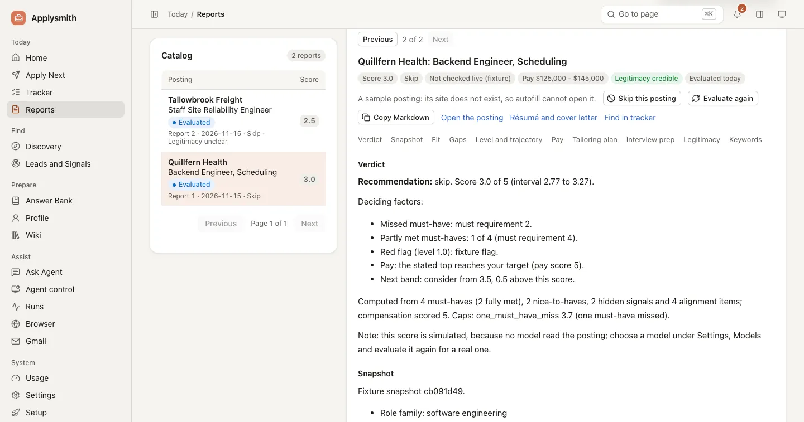

# Applysmith

Applysmith is a local-first job-search tool for macOS. It finds postings,
scores them against you, prepares tailored résumés and cover letters, fills
application forms in a Chrome window of its own, and keeps the status of every
application true. A desktop app, a dashboard, a command line and a Chrome
extension sit around one Go server on your own computer.

Your data stays in one folder you own. The only network traffic is to the
services you connect: a language-model provider, Gmail, Telegram, job boards
and the sites you apply to. Secrets go to the macOS keychain, never into a file.

## What it does

A day with Applysmith is a loop of eight moves, each available in the
dashboard and, where noted, on the command line:

| # | Move | Command |
|---|---|---|
| 1 | **Scan** job sources for new postings | `applysmith scan` |
| 2 | **Inbox**: decide what is worth a look | `applysmith inbox` |
| 3 | **Evaluate** a posting against your profile, with a scored report | `applysmith evaluate` |
| 4 | **Apply Next**: fill the form, review it, submit | `applysmith apply` |
| 5 | **Runs board**: finish what a run handed back to you | dashboard |
| 6 | **Tracker**: statuses, events and follow-ups | `applysmith tracker` |
| 7 | **Gmail**: replies move application statuses by themselves | `applysmith gmail` |
| 8 | **Ask Agent** and **Telegram**: ask, draft, get nudged | dashboard |

The Ask Agent runs on [pi](https://github.com/earendil-works/pi)
(`@earendil-works/pi-coding-agent`, pinned to 1.0.4) as its underlying agent:
the Go server drives pi over its RPC mode, supplies its tools and checks every
action through its own guard chain
([contract](docs/architecture/agent-pi-contract.md)).

Along the way it keeps an answer bank for application questions, a knowledge
base built from your CV and story, evidence-grounded documents typeset with
LaTeX, scheduled scans and hiring signals, and nightly verified backups.

## Rules it enforces

These are built into the product, not left to memory
([policies](docs/architecture/policies.md)):

- A dry run fills and stops before Submit. Submitting needs your explicit
  request for that application, or a confirmation in the dashboard.
- Schedules can scan, read mail and send digests; they can never fill a form,
  create an account, solve a captcha or submit.
- Work-authorization and self-identification answers come from you; a question
  it has no answer for is left blank, never invented.
- Applying to the same posting twice is stopped.
- Message drafts are never sent for you.

## Status

Version 0.0.1. macOS 13 or later and Google Chrome 120 or later; other
operating systems are unverified. There is no downloadable release yet, so build
from source. The app is signed ad hoc and not notarized; a build you make
yourself opens on the Mac that built it.

## Build and run

You need Go (`GOTOOLCHAIN=auto` fetches the pinned 1.27.1), Bun 1.3.5 and
Google Chrome.

    make build        # generated assets, then the binaries in bin/
    make app          # the signed desktop app in app/build/
    make package      # the app plus a disk image

See it working before entering anything of your own: the demo workspace uses a
fictional persona, sample postings and a sample form, and never submits,
creates accounts or sends mail.

    bin/applysmith demo init
    bin/applysmith serve --workspace ~/Applysmith-Demo
    bin/applysmith open      # prints a link to the dashboard

Then set up your own workspace step by step with `applysmith setup`, the
dashboard's Setup page, or the [setup guide](docs/setup/README.md).
`applysmith doctor` checks everything and says what to fix.

## Documentation

| I want to | Read |
|---|---|
| Install and set up | [docs/setup](docs/setup/README.md), one page per step |
| Use it day to day | [docs/user-guide](docs/user-guide/README.md), starting with the [demo tutorial](docs/user-guide/tutorial.md) |
| Understand how it is built | [architecture overview](docs/architecture/overview.md) |
| Let a coding agent drive the CLI | [skills/applysmith/SKILL.md](skills/applysmith/SKILL.md) |
| Contribute | [CONTRIBUTING.md](CONTRIBUTING.md), then [docs/development.md](docs/development.md) |
| Everything else | [docs/README.md](docs/README.md) |

## How it is built

| Piece | Where |
|---|---|
| Server: local API, scheduler, apply chain, agent (loopback only) | `internal/`, `cmd/applysmith` |
| Desktop app with menu-bar item | `app/` |
| Dashboard (React) | `web/` |
| Form autofill engine (TypeScript, runs in the page) | `engine/` |
| Chrome extension | `extension/` |
| Ask Agent: the pi agent over RPC, supervised by the server | `internal/agent` |
| PersonalCU computer-use companion (Swift) | `computeruse/` |

Storage is SQLite for runtime state, plain files for what you edit and the
keychain for secrets. Before a change lands, run `make verify` (vet, Go tests,
dashboard, engine and extension tests) and `make test-browser` (tests that need
a real Chrome).

## License

[MIT](LICENSE). Third-party notices are in [NOTICE](NOTICE).
