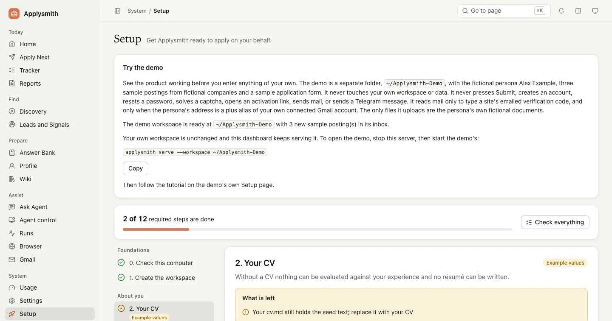
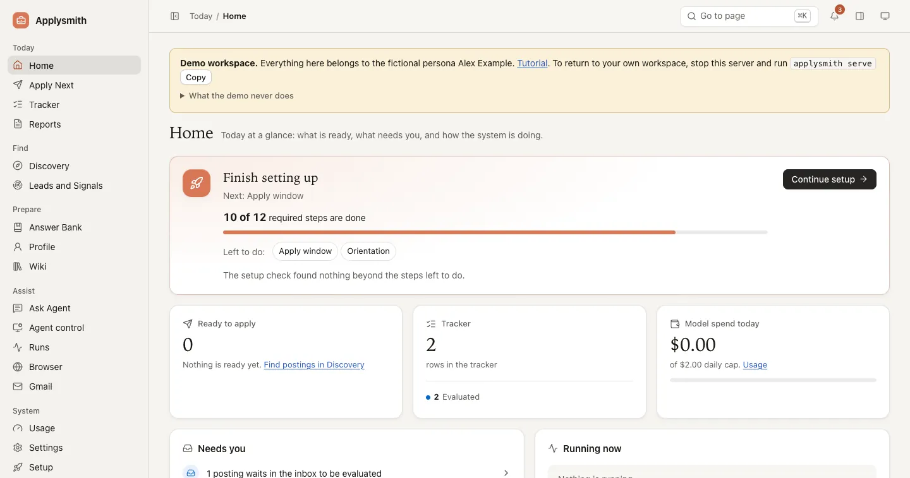
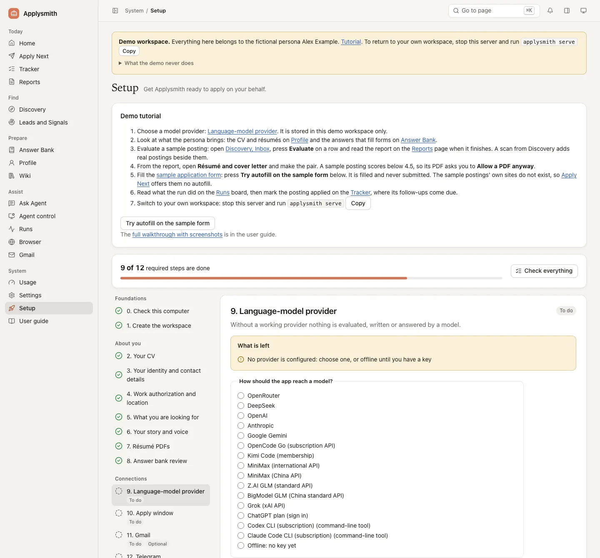
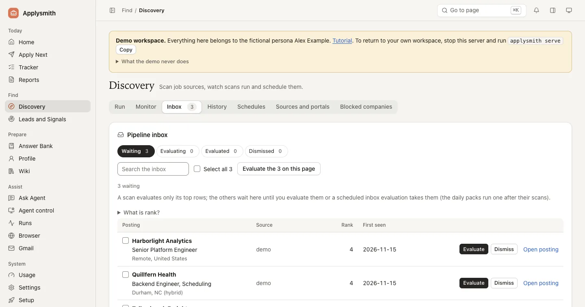
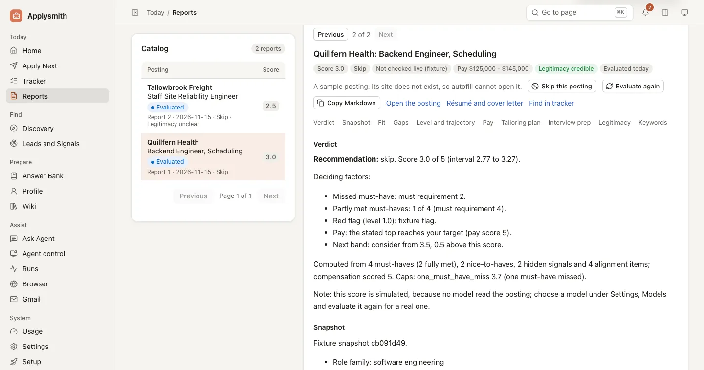
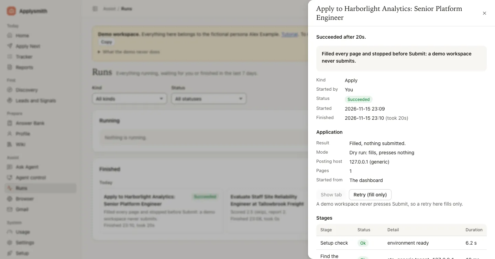
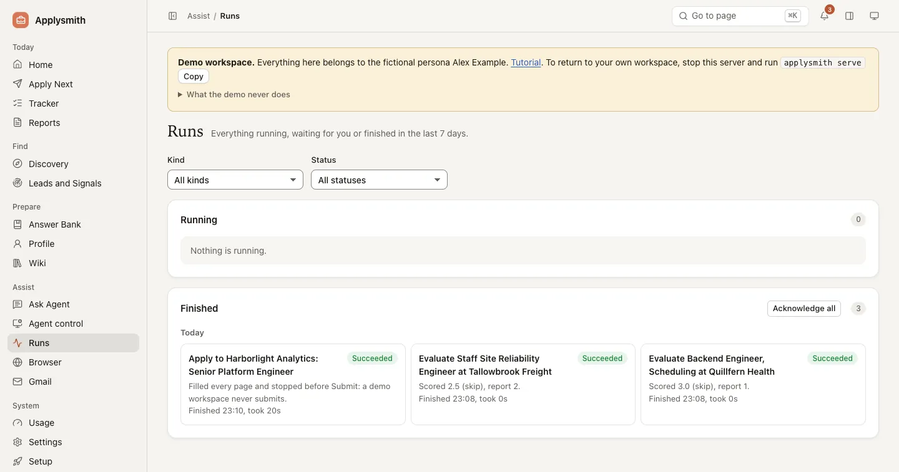

# Tutorial: the demo workspace

The demo workspace is a separate folder, `~/Applysmith-Demo`, set up as a
fictional job seeker named Alex Example. It lets you see the whole loop before
you type anything about yourself: a few sample postings wait in the inbox, the
profile, résumé and answer bank are already filled in, and a sample application
form is served from your own computer.

A demo workspace never presses Submit, creates an account, resets a password,
solves a captcha, opens an activation link, sends mail, or sends a Telegram
message. It reads mail for one thing only: a site's emailed verification code,
and only if you connect your own Gmail account and give the persona a plus
alias of it (see the optional step after step 6). The only files it uploads are
the persona's own fictional documents, so a dry run on a real posting attaches
Alex Example's résumé. Each
refusal is recorded with the reason `demo_workspace`, so you can see where a real run would have gone
further. The marker that makes a folder a demo cannot be removed from the
dashboard or the command line.

The tutorial takes about fifteen minutes. The only account it can use is a
language-model provider in step 3, and the Offline choice there needs none.

## 1. Create the demo

From the dashboard: open the Setup page and press **Create the demo
workspace** in the "Try the demo" panel. The panel shows the folder, the
number of sample postings and the command that starts it. The button works only
on this computer; a phone or another computer reaching the dashboard remotely
cannot create a demo.



From a Terminal window:

```
applysmith demo init
```

`--workspace <folder>` puts the demo somewhere other than `~/Applysmith-Demo`.
The command refuses, and writes nothing, when the folder holds or sits inside a
workspace that is not a demo; your own workspace is never mixed with the
example persona. Running it again adds nothing twice and keeps any edits you
made to the demo's files.

## 2. Start the demo

In the Applysmith app, press **Open the demo workspace** under the result of
step 1: the app restarts its server on the demo and reloads the dashboard
there. If work is running it names it first and asks. Your own workspace stays
the one the app opens the next time it starts.

Without the app, only one server runs at a time. Stop `applysmith serve` if it is
running for your own workspace, then start the demo:

```
applysmith serve --workspace ~/Applysmith-Demo
```

Every command run against the demo prints a line saying it is the demo and
what it never does. Open the dashboard link it prints. Every page carries a
banner saying this is the demo workspace, with a link to the tutorial.



## 3. Look at setup and choose a provider

Open the Setup page. The steps the persona fills (CV, identity, work
authorization, targets, story, résumés, answer bank) show as complete with the
reason "demo persona". Outside a demo, the same example values would read as a
template that still needs your own.

The one step the demo cannot fill for you is the language-model provider
(step 9). Choose one the way the setup guide describes
([step 9](../setup/09-llm.md)). The choice and its key are stored in
the demo workspace only; your own workspace does not see them. With no key at
hand, the Offline choice works too: a stand-in provider writes the reports and
each report says so. The Ask Agent needs a real model and does not answer then.



## 4. Evaluate a sample posting

The demo's inbox holds three sample postings from fictional companies on
reserved `.example` domains. One of them is a deliberate mismatch for the
persona, so you can see a low score as well as a good one.

Open the Discovery page and choose the **Inbox** tab (or go to
`http://127.0.0.1:47319/discovery?tab=inbox`). It lists the postings that wait
to be evaluated, with company, role, location, source, local rank and the day
each was first seen. Press **Evaluate** on a row. The page says the evaluation
started and the row moves to **Evaluating**; when the run ends the row moves to
**Evaluated** with a link to its report. **Open posting** shows the posting
itself, and **Dismiss** removes a row you do not want evaluated.

Those domains do not exist, so the demo reads each sample posting from its own
copy rather than the network, and the report marks the posting as unverified.
Evaluate the mismatch too if you like.

From a Terminal window the same step is a command. It works while the demo
server runs, because the command hands the evaluation to that server:

```
applysmith inbox list --workspace ~/Applysmith-Demo
applysmith evaluate <inbox-row-id> --workspace ~/Applysmith-Demo
```

Open the Reports page: each report has its score, its band and the evidence
behind each part of the score, including why the mismatch scores low.





## 5. Autofill the sample application form

The demo serves a sample application form at
`http://127.0.0.1:47319/demo/sample-application` (the dashboard's own address
with that path; 47319 is the default port). It asks for a name, email, phone,
city, a résumé, work authorization, sponsorship and a work mode. Its Submit
button sends nothing anywhere.

With the demo server running, open the Setup page and press **Try autofill on
the sample form** in the "Demo tutorial" panel. The dashboard starts a dry run
on that address and links to it; follow the link to watch it on the Runs page.
The run fills every field from the persona, attaches the persona's fictional
résumé and stops before Submit. Adding
`--submit` on the command line changes nothing in the demo: the submit is
refused with `demo_workspace` and the run ends as a dry run.

From a Terminal window the same run is a command:

```
applysmith apply http://127.0.0.1:47319/demo/sample-application --workspace ~/Applysmith-Demo
```



## 6. Read the Runs board

Open the Runs page. The application run sits under Finished as a dry run. Open
its card to see each stage: the pages it filled, the fields it filled on each,
and the submit stage, skipped with "dry run: demo_workspace". A dry run on a real
posting's page works the same way: the persona's résumé is attached, and the
upload is recorded with the site's host.



## Optional: let the demo read one emailed code

Some sites (ADP is one) mail a verification code before they show the form. By
default the demo stops there and leaves the filled tab to you. To let a dry run
get past it, the code has to reach a mailbox the demo may read, and the demo may
read only your own Gmail account, only for that one mail:

1. Connect Gmail to the demo workspace. Follow
   [the Gmail setup](../setup/11-gmail.md) using `--workspace ~/Applysmith-Demo` on
   each command: `applysmith gmail connect --address <your Gmail address>
   --password-stdin` with an app password, then `applysmith gmail test`. The access
   is read-only and the test counts messages without opening any.
2. Give the persona a plus alias of that account: `applysmith demo email
   you+applysmithdemo@<your Gmail domain> --workspace ~/Applysmith-Demo`. The command
   refuses anything that is not a plus alias of the connected account. Gmail
   delivers the alias to your inbox.
3. Run a dry run on the posting. When the site mails its code, the run reads
   only the newest mail from that site's sender that arrived after the dialog
   opened, types it and presses Verify. It never reads any other mail, and a
   run that asks to submit does not read the code at all.

Each decision, allowed or refused, is recorded with the reason `demo_workspace`.
A sync, digest or scan of Gmail never runs in the demo.

## 7. Switch to your own workspace

In the app, press **Back to my workspace** in the demo banner (or choose Back
to My Workspace in the menu bar item). Without the app, stop the demo server
(Control-C in its Terminal window) and run `applysmith serve` without
`--workspace`; the banner has the command with a Copy button. Either way you
get your own workspace, which the demo never recorded or changed. Set it up with your own
details by following [the setup guides](../setup/README.md).

The demo folder stays where it is. Start it again any time with
`applysmith serve --workspace ~/Applysmith-Demo`, or delete the folder when you no
longer want it.
